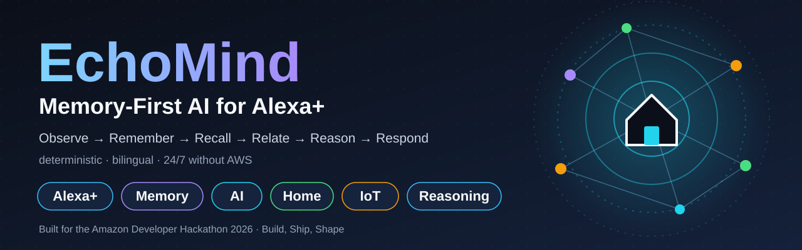
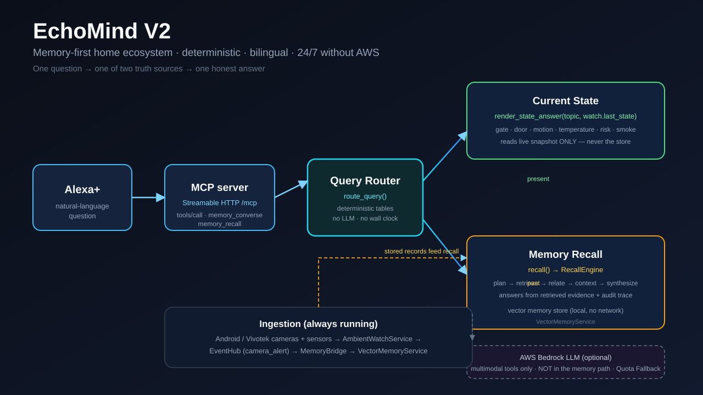
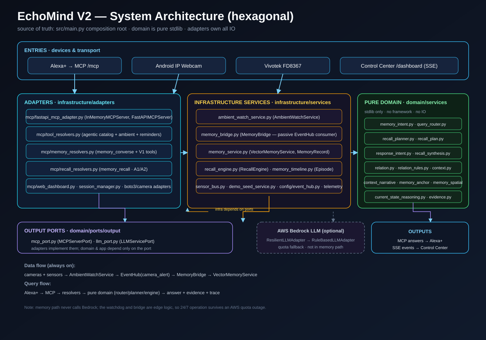
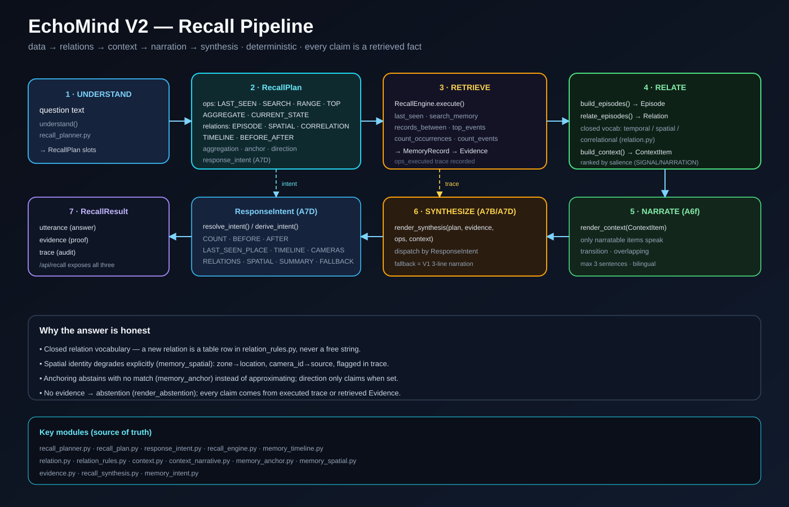
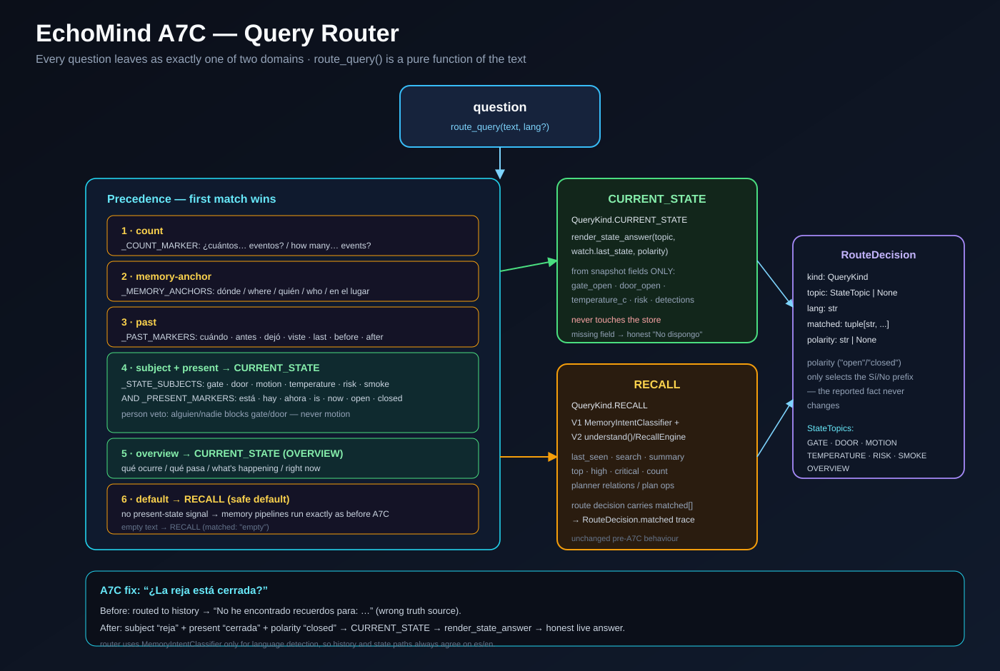
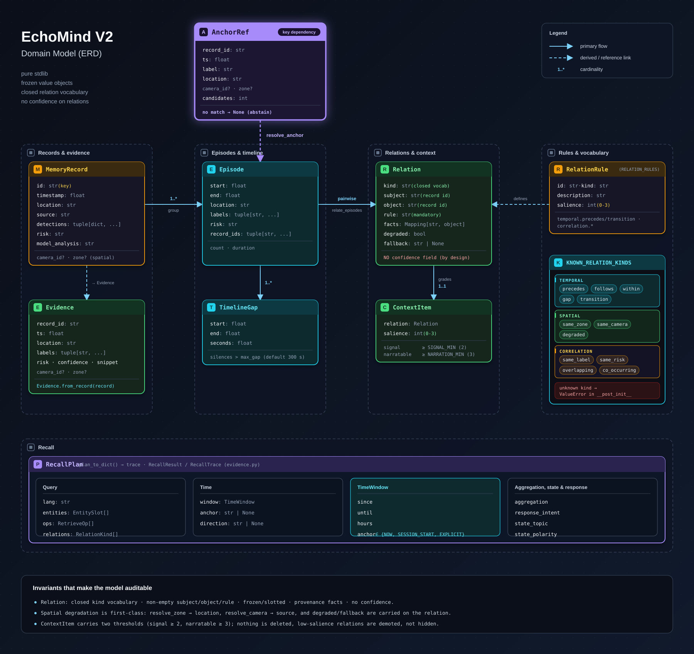

<div align="center">

<a href="./docs/assets/hackathon-banner.svg">
  
</a>

# EchoMind

### Memory-First AI for Alexa+

**Observe → Remember → Recall → Relate → Reason → Respond**

[](https://developer.amazon.com/docs/alexaplus/add-ons/mcp-toolkit-overview.html)
[](https://builder.aws.com/content/3JP06xAFFqTUXpD9kECgYcjVHWQ/aws-hackathons-still-open-build-compete-and-ship-before-october-ends)
[](https://amazonappdev2026.devpost.com/)
[](#10-alexa-integration)
[](#6-system-architecture)
[](#18-license)

*Memory-first home ecosystem · deterministic · bilingual · 24/7 without AWS*

**[Judge Quick Start](#2-judge-quick-start)** · [Architecture](#6-system-architecture) · [Known Limitations](#15-known-limitations) · [Documentation](#17-project-documentation)

</div>

## Contents

| | |
| --- | --- |
| **Start here** | [1. Overview](#1-overview) · [2. Judge Quick Start](#2-judge-quick-start) |
| **Understand** | [3. What is EchoMind](#3-what-is-echomind) · [4. Why it is different](#4-why-echomind-is-different) · [5. Core capabilities](#5-core-capabilities) |
| **Architecture** | [6. System architecture](#6-system-architecture) · [7. Memory reasoning pipeline](#7-memory-reasoning-pipeline) · [8. Query router](#8-query-router) · [9. Domain model](#9-domain-model) |
| **Integrations** | [10. Alexa+](#10-alexa-integration) · [11. AWS Builder](#11-aws-builder-integration) |
| **Run it** | [12. Getting started](#12-getting-started) · [13. Testing](#13-testing) |
| **Project** | [14. Status](#14-project-status) · [15. Known limitations](#15-known-limitations) · [16. Roadmap](#16-roadmap) · [17. Project documentation](#17-project-documentation) · [18. License](#18-license) |
| **Diagrams** | [Overview](#1-overview) · [System architecture](#6-system-architecture) · [Memory reasoning](#7-memory-reasoning-pipeline) · [Query router](#8-query-router) · [Domain model](#9-domain-model) |

> **Judges, 2-minute path:** [Overview](#1-overview) → [Query router](#8-query-router) → [Where Bedrock is, and is not](#11-aws-builder-integration) → [Judge Quick Start](#2-judge-quick-start) → [Known limitations](#15-known-limitations)

---

## 1. Overview

<p align="center">
  <a href="./docs/assets/hero.svg">
    
  </a>
  <br/><sub>Click to open full size</sub>
</p>

> **One question → one of two truth sources → one honest answer.**

Ask Alexa+ *"¿La reja está cerrada?"* and EchoMind answers from the **live snapshot**.
Ask *"¿Cuándo viste a alguien por última vez?"* and it answers from **retrieved memory**, with the
evidence and the audit trace that prove it. Ask something it cannot support and it **abstains**
instead of guessing.

The memory path is **deterministic and uses no LLM**. If AWS throttles, rejects credentials or
runs out of quota, Alexa+ keeps remembering and answering.

---

## 2. Judge Quick Start

> **Five minutes. No AWS credentials, no camera and no Alexa device needed.** The memory path is local and deterministic, so nothing below calls a cloud service.

| Time | Step | What it shows |
| ---- | ---- | ------------- |
| 0:00 | **Read** the [overview diagram](#1-overview) and the [router precedence table](#8-query-router) | Every question leaves as exactly one of two domains: `CURRENT_STATE` or `RECALL` |
| 1:00 | **Start** the server, Docker or local ([Getting Started](#12-getting-started)) | It boots with no AWS credentials |
| 2:00 | **Ask before seeding** | With an empty memory the system abstains instead of guessing |
| 2:30 | **Seed** the demo memory and **ask again** | The answer, its `evidence` and its `trace` come back together |
| 3:30 | **Ask a present-tense question** | It is answered from the live snapshot, not from memory |
| 4:15 | **Check** `/metrics` and run the offline test suite | Tool counts and quota-fallback activations are observable; tests need no network |

**1. Start**

```bash
docker compose up --build -d      # or follow steps 1-3 of Getting Started
curl http://localhost:8000/health
```

**2. Ask before seeding.** Define a helper once, then ask a past-tense question:

```bash
# bash / zsh / Git Bash
ask() { curl -s -X POST http://localhost:8000/api/recall -H "Content-Type: application/json" -d "{\"query\": \"$1\"}"; echo; }
ask "¿Cuándo viste a alguien por última vez?"
```

```powershell
# PowerShell
function Ask($q) { Invoke-RestMethod -Method Post -Uri http://localhost:8000/api/recall -ContentType 'application/json; charset=utf-8' -Body ([Text.Encoding]::UTF8.GetBytes((@{ query = $q } | ConvertTo-Json))) }
Ask "¿Cuándo viste a alguien por última vez?"
```

**3. Seed, then ask again**

```bash
curl -X POST http://localhost:8000/api/demo/seed
ask "¿Cuándo viste a alguien por última vez?"
```

```powershell
Invoke-RestMethod -Method Post -Uri http://localhost:8000/api/demo/seed
Ask "¿Cuándo viste a alguien por última vez?"
```

**4. Present tense, and English**

```bash
ask "¿La reja está cerrada?"
ask "How many events today?"
```

**5. Observe and verify**

```bash
curl http://localhost:8000/metrics
pytest -q
```

**What to look for**

- **Before seeding:** `response` is an abstention and `evidence` is empty.
- **After seeding:** the JSON carries `response` (the answer), `evidence` (the retrieved records) and `trace` (the plan and the operations executed).
- **Present tense:** *"¿La reja está cerrada?"* is routed to `CURRENT_STATE` and answered from the live snapshot, or with an honest *"No dispongo…"* if that field is missing ([Query Router](#8-query-router)).
- **Determinism:** the same question over the same memory returns the same answer. Relative phrases such as *"hace 2 horas"* advance with the clock.
- **No cloud on the memory path:** Bedrock appears only under the multimodal and ambient tools ([Where Bedrock is, and is not](#11-aws-builder-integration)).

Next: [Known Limitations](#15-known-limitations) · [Project Documentation](#17-project-documentation)

<!-- RC-VERIFY before publishing (delete this comment afterwards):
     1. HTTP method of /api/demo/seed in src/main.py (POST assumed above).
     2. That /api/recall routes present-tense questions through route_query with the live-state provider wired.
     3. That `scripts/` is tracked (see Getting Started) and LICENSE exists. -->

---

## 3. What is EchoMind

EchoMind gives **Alexa+** a memory of the home. It watches through cameras and sensors, remembers
what mattered, and reasons over that memory to answer natural-language questions in Spanish and
English.

**EchoMind is Memory-First AI:**

```
Observe  →  Remember  →  Recall  →  Relate  →  Reason  →  Respond
```

| Stage | What happens | Where it lives |
| ----- | ------------ | -------------- |
| **Observe** | Android and Vivotek cameras plus home sensors feed a background watchdog | `AmbientWatchService` |
| **Remember** | High-risk observations are coalesced and persisted as vector memory | `MemoryBridge` → `VectorMemoryService` |
| **Recall** | A question is understood as a structured plan and executed against the store | `understand()` → `RecallPlan` → `RecallEngine` |
| **Relate** | Records become episodes, episodes become typed relations, relations become graded context | `Episode` → `Relation` → `ContextItem` |
| **Reason** | A deterministic router decides *present* vs *past*; current state is read from the live snapshot | `route_query` · `current_state_reasoning` |
| **Respond** | The answer is narrated and synthesised from evidence, bilingual, with proof and trace | `render_context` · `render_synthesis` |

**EchoMind is not:**

- **A CCTV system.** Cameras are senses, not the product.
- **A dashboard.** The Control Center is an operational and demo console.
- **A motion detector.** Motion is one input among several, never the answer.
- **A chatbot.** Every claim comes from a retrieved fact or a live snapshot field.

---

## 4. Why EchoMind is different

| | CCTV / NVR | Dashboards | Motion detectors | Chatbots | **EchoMind** |
| - | :-: | :-: | :-: | :-: | :-: |
| Remembers what happened | recording only | partial | no | no | **yes, as structured memory** |
| Answers in natural language | no | no | no | yes | **yes, es / en** |
| Distinguishes *now* from *before* | no | no | no | no | **yes, by deterministic router** |
| Relates events to each other | no | no | no | no | **yes, closed relation vocabulary** |
| Shows its evidence | no | partial | no | no | **yes, evidence and trace on every answer** |
| Abstains when it does not know | n/a | n/a | n/a | rarely | **yes, by design** |
| Works without a cloud LLM | yes | yes | yes | no | **yes, memory path never calls an LLM** |

**Design decisions that define EchoMind V2:**

1. **Two truth sources, never mixed.** Present-tense questions are answered from `watch.last_state`
   and never touch the store. Past-tense questions are answered from memory.
2. **The memory path is deterministic.** No LLM and no wall clock inside the router, planner or
   engine, so the same question over the same memory gives the same answer.
3. **Closed relation vocabulary.** A new relation type is a row in `relation_rules.py`, never a
   free-form string. Relations carry **no `confidence`** field: a deterministic engine does not
   pretend to be "80% sure".
4. **Explicit degradation.** Spatial identity degrades `zone → location` and `camera_id → source`
   and is flagged in the trace. Anchoring abstains on no match. Missing live fields yield an
   honest *"No dispongo…"*.
5. **Hexagonal core.** The domain is pure stdlib. Frameworks, SDKs and IO live in adapters behind
   ports.

---

## 5. Core Capabilities

| Capability | What it does | Source of truth |
| ---------- | ------------ | --------------- |
| **Android Camera** | Phone camera via IP Webcam, exposed at `/api/cam/phone/*` | `HttpPhoneCameraAdapter` |
| **Vivotek Camera** | Vivotek FD8367 IP camera, exposed at `/api/cam/vivotek/*` | `VivotekCameraAdapter` |
| **MemoryBridge** | Passive `EventHub` subscriber. Persists coalesced HIGH / CRITICAL events | `memory_bridge.py` |
| **VectorMemoryService** | Local vector memory of `MemoryRecord`s: `last_seen`, `search_memory`, `records_between`, `top_events`, `count_occurrences`, `count_events`, `label_counts` | `memory_service.py` |
| **Recall Engine** | Executes a `RecallPlan` (`LAST_SEEN`, `SEARCH`, `RANGE`, `TOP`, `AGGREGATE`, `CURRENT_STATE`) and records the `ops_executed` trace | `recall_engine.py` · `recall_planner.py` |
| **Timeline** | Groups records into `Episode`s by `location` + `labels` and `gap_seconds`; detects `TimelineGap` silences | `memory_timeline.py` |
| **Spatial Memory** | Identity degrades explicitly (`zone → location`, `camera_id → source`); anchoring resolves a reference or abstains | `memory_spatial.py` · `memory_anchor.py` |
| **Relation Engine** | `relate_episodes()` applies `RELATION_RULES` to produce `Relation`s from a closed vocabulary: temporal, spatial, correlational | `relation.py` · `relation_rules.py` |
| **Context Layer** | `build_context()` grades each relation into a `ContextItem` with two thresholds: `SIGNAL_MIN` and `NARRATION_MIN` | `context.py` |
| **Narration Layer** | `render_context()` speaks only narratable items, at most 3 sentences, bilingual | `context_narrative.py` |
| **Current State Reasoning** | Answers gate, door, motion, temperature, risk and smoke from the live snapshot only | `current_state_reasoning.py` |
| **Query Router** | `route_query()` sends each question to exactly one domain: `CURRENT_STATE` or `RECALL` | `query_router.py` |
| **Alexa+** | MCP client. Calls EchoMind tools over Streamable HTTP | `FastAPIMCPServer` at `/mcp` |
| **AWS Bedrock** | Multimodal and ambient analysis through the Converse API, with Quota Fallback. Optional | `BedrockLLMAdapter` |
| **MCP** | Streamable HTTP transport, tool registry and session management | `fastapi_mcp_adapter.py` · `session_manager.py` |

---

## 6. System Architecture

<p align="center">
  <a href="./docs/diagrams/system-architecture.svg">
    
  </a>
  <br/><sub>Click to open full size</sub>
</p>

All business rules live in a pure domain. Adapters own every side effect. `src/main.py:compose()` is
the composition root that wires everything together.

| Layer | Path | Responsibility |
| ----- | ---- | -------------- |
| **Entries** | devices and transport | Alexa+ → MCP `/mcp` · Android IP Webcam · Vivotek FD8367 · Control Center `/dashboard` (SSE) |
| **Adapters** | `infrastructure/adapters` | `mcp/` (server, resolvers, session manager, dashboard) · `aws/` (Bedrock, fallback) · `camera/` · `iot/` |
| **Infrastructure services** | `infrastructure/services` | `AmbientWatchService` · `MemoryBridge` · `VectorMemoryService` · `RecallEngine` · `memory_timeline` · `sensor_bus` · `demo_seed_service` · `EventHub` · `Telemetry` |
| **Pure domain** | `domain/services` | stdlib only, no framework, no IO: router, planner, relations, context, narration, synthesis, current-state reasoning |
| **Output ports** | `domain/ports/output` | `MCPServerPort` · `LLMServicePort`. Adapters implement them; the domain depends only on ports |
| **Outputs** | | MCP answers → Alexa+ · SSE events → Control Center |

**Two flows, always separated:**

```
Data flow (always on)
  cameras + sensors → AmbientWatchService → EventHub (camera_alert) → MemoryBridge → VectorMemoryService

Query flow
  Alexa+ → MCP → resolvers → pure domain (router / planner / engine) → answer + evidence + trace
```

**Dependency rule**

- `src/domain/`: pure core. No FastAPI, no boto3, no MCP SDK, no IO.
- `src/application/`: use cases orchestrated through domain ports.
- `src/infrastructure/`: concrete adapters and services. The only layer that touches frameworks and SDKs.
- `tests/`: run against mocked ports, with no network and no AWS.

> The memory path never calls Bedrock. The watchdog and the bridge are edge logic, so 24/7
> operation survives an AWS quota outage.

---

## 7. Memory Reasoning Pipeline

<p align="center">
  <a href="./docs/diagrams/memory-reasoning.svg">
    
  </a>
  <br/><sub>Click to open full size</sub>
</p>

`data → relations → context → narration → synthesis`. Every step builds an auditable structure and
every claim is a retrieved fact.

| # | Step | Entry point | Output |
| - | ---- | ----------- | ------ |
| 1 | **Understand** | `understand()` in `recall_planner.py` | question text → `RecallPlan` slots |
| 2 | **Plan** | `RecallPlan` in `recall_plan.py` | `ops`, `relations`, `aggregation`, `anchor`, `direction`, `response_intent` |
| 3 | **Retrieve** | `RecallEngine.execute()` | `MemoryRecord` → `Evidence`, with `ops_executed` trace |
| 4 | **Relate** | `build_episodes()` → `relate_episodes()` → `build_context()` | `Episode` → `Relation` → `ContextItem`, ranked by salience |
| 5 | **Narrate** | `render_context()` | only narratable items speak: transition, overlapping; max 3 sentences; bilingual |
| 6 | **Synthesize** | `render_synthesis(plan, evidence, ops, context)` | dispatch by `ResponseIntent`; fallback is the V1 3-line narration |
| 7 | **Result** | `RecallResult` | `utterance` (answer) · `evidence` (proof) · `trace` (audit) |

**`RecallPlan` vocabulary**

- **Ops (`RetrieveKind`):** `LAST_SEEN` · `SEARCH` · `RANGE` · `TOP` · `AGGREGATE` · `CURRENT_STATE`
- **Relations (`RelationKind`):** `EPISODE` · `SPATIAL` · `CORRELATION` · `TIMELINE` · `BEFORE_AFTER`
- **Response intent (`ResponseIntent`, A7D):** `COUNT` · `BEFORE` · `AFTER` · `LAST_SEEN_PLACE` · `TIMELINE` · `CAMERAS` · `RELATIONS` · `SPATIAL` · `SUMMARY` · `FALLBACK`

**Why the answer is honest**

- **Closed relation vocabulary.** New relations are table rows in `relation_rules.py`.
- **Explicit spatial degradation.** `zone → location` and `camera_id → source` are flagged in the trace.
- **Abstention on no match.** `memory_anchor` abstains instead of approximating. `direction` only claims when set.
- **No evidence, no claim.** Without evidence, `render_abstention` answers. Every statement comes from the executed trace or retrieved `Evidence`.

`/api/recall` exposes the utterance, the evidence and the trace together.

> Deep dive: [`ECHOMIND_V2_MEMORY_FIRST_ARCHITECTURE.md`](docs/architecture/ECHOMIND_V2_MEMORY_FIRST_ARCHITECTURE.md) (Spanish)

---

## 8. Query Router

<p align="center">
  <a href="./docs/diagrams/query-router.svg">
    
  </a>
  <br/><sub>Click to open full size</sub>
</p>

Every question leaves as **exactly one of two domains**. `route_query(text, lang?)` is a pure
function of the text: no LLM, no wall clock.

**Precedence: first match wins**

| # | Rule | Markers | Result |
| - | ---- | ------- | ------ |
| 1 | **count** | `_COUNT_MARKER`: ¿cuántos… eventos? / how many… events? | `RECALL` |
| 2 | **memory-anchor** | `_MEMORY_ANCHORS`: dónde / where / quién / who / en el lugar | `RECALL` |
| 3 | **past** | `_PAST_MARKERS`: cuándo · antes · dejó · viste · last · before · after | `RECALL` |
| 4 | **subject + present** | `_STATE_SUBJECTS` (gate, door, motion, temperature, risk, smoke) **and** `_PRESENT_MARKERS` (está, hay, ahora, is, now, open, closed) | `CURRENT_STATE` |
| 5 | **overview** | qué ocurre / qué pasa / what's happening / right now | `CURRENT_STATE` (`OVERVIEW`) |
| 6 | **default** | nothing matched, including empty text | `RECALL`: safe default, zero regression |

Person veto: `_PERSON_ANCHORS` (*alguien*, *nadie*) blocks `GATE` and `DOOR` (state of a thing) but
never `MOTION`.

**The two branches**

| | `CURRENT_STATE` | `RECALL` |
| - | --------------- | -------- |
| Handler | `render_state_answer(topic, watch.last_state, polarity)` | V1 `MemoryIntentClassifier` + V2 `understand()` / `RecallEngine` |
| Reads | snapshot fields only: `gate_open`, `door_open`, `temperature_c`, `risk`, `detections` | `VectorMemoryService` |
| Touches the store | **never** | yes |
| Missing data | honest *"No dispongo…"* | abstention |

**`RouteDecision`:** `kind: QueryKind` · `topic: StateTopic` · `lang` · `matched` · `polarity`.
`StateTopic` is `GATE` · `DOOR` · `MOTION` · `TEMPERATURE` · `RISK` · `SMOKE` · `OVERVIEW`.
`polarity` (`open` / `closed`) only selects the *Sí / No* prefix; the reported fact never changes.

**The A7C fix.** *"¿La reja está cerrada?"* used to be routed to history and answered *"No he
encontrado recuerdos…"*, the wrong truth source. Now subject `reja` + present marker `cerrada` +
polarity `closed` → `CURRENT_STATE` → `render_state_answer` → a live, honest answer.

> Deep dive: [`A7C_QUERY_ROUTER_ARCHITECTURE.md`](docs/implementation/A7C_QUERY_ROUTER_ARCHITECTURE.md) (Spanish)

---

## 9. Domain Model

<p align="center">
  <a href="./docs/diagrams/domain-erd.svg">
    
  </a>
  <br/><sub>Click to open full size</sub>
</p>

Pure domain structures behind the pipeline. `MemoryRecord` lives in infrastructure but is the source
record for everything else.

| Entity | Module | Fields |
| ------ | ------ | ------ |
| `MemoryRecord` | `memory_service.py` | `id` · `timestamp` · `location` · `source` · `detections` · `risk` · `model_analysis` · `camera_id?` · `zone?` |
| `Evidence` | `evidence.py` | `record_id` · `ts` · `location` · `labels` · `risk` · `confidence` · `snippet` · `camera_id?` · `zone?` |
| `Episode` | `memory_timeline.py` | `start` · `end` · `location` · `labels` · `risk` · `record_ids` (+ `count`, `duration`) |
| `TimelineGap` | `memory_timeline.py` | `start` · `end` · `seconds` |
| `Relation` | `relation.py` | `kind` · `subject` · `object` · `rule` · `facts` · `degraded` · `fallback` |
| `RelationRule` | `relation_rules.py` | `id` · `kind` · `description` · `salience` |
| `ContextItem` | `context.py` | `relation` · `salience` (+ `signal`, `narratable`, `degraded`) |
| `AnchorRef` | `memory_anchor.py` | `record_id` · `ts` · `label` · `location` · `camera_id?` · `zone?` · `candidates` |
| `RecallPlan` | `recall_plan.py` | `lang` · `window` (`TimeWindow`) · `entities` (`EntitySlot`) · `ops` (`RetrieveOp`) · `relations` · `aggregation` · `anchor` · `direction` · `state_topic` · `state_polarity` · `response_intent` |
| `RecallResult` / `RecallTrace` | `evidence.py` | `utterance` · `evidence` · `trace` · `context` |

**Relationships**

| From | Cardinality | To | Note |
| ---- | ----------- | -- | ---- |
| `MemoryRecord` | 1..* | `Episode` | grouped by `location` + `labels` and `gap_seconds` |
| `Episode` | 1..* | `TimelineGap` | silences longer than `max_gap` |
| `Episode` | pairwise | `Relation` | via `relate_episodes`; `RelationRule` defines each row |
| `Relation` | 1..1 | `ContextItem` | graded by `salience` |
| `MemoryRecord` | → | `Evidence` | retrieval output |
| `AnchorRef` | resolved from | `MemoryRecord` | most recent record with the label; `RecallPlan.anchor` references that label |
| `RecallPlan` | 1..* | `RetrieveOp` | and 0..* `RelationKind` |

**Invariants that make the model auditable**

- `Relation`: closed kind vocabulary (`KNOWN_RELATION_KINDS` = `TEMPORAL_KINDS`, `SPATIAL_KINDS`, `CORRELATIONAL_KINDS`), non-empty subject, object and rule, frozen and slotted, provenance facts, **no confidence**.
- Spatial degradation is first-class: `resolve_zone → location`, `resolve_camera → source`, and `degraded` / `fallback` are carried on the relation.
- `ContextItem` carries two thresholds (`signal ≥ 2`, `narratable ≥ 3`). Nothing is deleted; low-salience relations are demoted, not hidden.

---

## 10. Alexa+ Integration

Alexa+ talks to EchoMind as an **MCP client** over the HTTP **Streamable** transport (spec
`2025-11-25`).

| Piece | Detail |
| ----- | ------ |
| **Endpoint** | `GET / POST /mcp` served by `FastAPIMCPServer` |
| **Skill manifest** | `alexa_skill/skill.json`, an Alexa+ Agent Skill manifest (MCP streamable) |
| **Tool surface** | `AGENTIC_TOOL_CATALOG` in `src/domain/models/tools.py`: **9 tools**, of which **5 are memory tools** (`MEMORY_TOOL_NAMES`) |
| **Memory tools** | Two parallel channels: V1 `memory_converse` and V2 `memory_recall` (plan → retrieve → relate → synthesize) |
| **Other tools** | `analyze_image_context` · `summarize_document` · `schedule_reminder` · `analyze_ambient_stream` |
| **Sessions** | `SessionManager`, with idle expiry and an SSE keep-alive |
| **Auxiliary HTTP routes** | `/api/converse` · `/api/recall` · `/dashboard` · `/api/cam/*` · `/metrics` · `/health` |

**What Alexa+ can ask, and where it goes**

| Question | Router decision |
| -------- | --------------- |
| *"¿La reja está cerrada?"* | `CURRENT_STATE` · `GATE` · polarity `closed` |
| *"What's happening right now?"* | `CURRENT_STATE` · `OVERVIEW` |
| *"¿Cuándo viste a alguien por última vez?"* | `RECALL` (past marker) |
| *"Where was the last event?"* | `RECALL` (memory anchor) |
| *"How many events today?"* | `RECALL` (count) |

**Proactive side.** `AmbientWatchService` runs for the whole server lifetime. It merges camera
motion (`frame_delta_ratio`) with the sensor bus (smoke, temperature, gate and door switches, pet
collar), computes an explainable risk verdict, and publishes `camera_alert` events on `EventHub`.
`MemoryBridge` persists the HIGH / CRITICAL ones.

---

## 11. AWS Builder Integration

AWS Bedrock is the LLM provider for the **multimodal and ambient tools**. It is deliberately **not
in the memory path**, so memory answers never depend on a cloud call.

| Capability | Implementation |
| ---------- | -------------- |
| **Amazon Bedrock Converse API** | `BedrockLLMAdapter` (`adapters/aws/bedrock_adapter.py`) translates `LLMRequest.attachments` into Converse content blocks |
| **Multimodal input** | Images, video, audio and documents (PDF, DOCX, XLSX, CSV, TXT, MD). No media type leaks into the domain |
| **Default model** | `amazon.nova-micro-v1:0` in `us-east-1` (configurable) |
| **Graceful fallback** | `ResilientLLMAdapter` wraps Bedrock and fails over to `RuleBasedLLMAdapter`, which implements the same `LLMServicePort` contract |
| **Quota Fallback Protocol** | On throttling, rejected credentials or exhausted quota, the adapter falls back transparently. A circuit breaker (`ECHOMIND_FALLBACK_COOLDOWN_SECONDS`, default 300) waits before probing Bedrock again |
| **MCP continuity** | The MCP session with Alexa+ never breaks during a fallback |
| **Credentials** | Standard AWS chain: `~/.aws/credentials`, environment variables or an IAM role. Never committed |
| **Zero-credentials mode** | With no AWS credentials on the host, the server still answers an ambient CRITICAL alert end to end |
| **Observability** | `GET /metrics` reports `fallbacks_activated` alongside tool counts and latency percentiles |
| **Packaging** | Multi-stage Docker build on `python:3.11-slim` with a uvicorn healthcheck |

**Where Bedrock is, and is not**

| In the path | Not in the path |
| ----------- | --------------- |
| `analyze_image_context` · `summarize_document` · `analyze_ambient_stream` (multimodal / ambient tools) | `route_query` · `understand()` · `RecallEngine` · `render_synthesis` · `render_state_answer` |

---

## 12. Getting Started

```powershell
# 1. Create and activate a virtual environment
python -m venv .venv
.\.venv\Scripts\Activate.ps1

# 2. Install dependencies
pip install -r requirements.txt

# 3. Start the MCP Streamable HTTP server (no AWS required)
python -m uvicorn src.main:app --host 0.0.0.0 --port 8000
```

Check it is alive:

```powershell
curl http://localhost:8000/health
curl http://localhost:8000/metrics
```

`/metrics` is a dependency-free snapshot: uptime, per-tool call counts, quota-fallback activations
and request latency percentiles (p50 / p95 / p99).

**Docker**

```powershell
docker compose up --build -d
curl http://localhost:8000/health
```

**Control Center (`/dashboard`): operational and demo console, not the product**

Open [http://localhost:8000/dashboard](http://localhost:8000/dashboard). It subscribes to the SSE
stream at `/dashboard/events` and polls `/metrics`. Its camera viewer offers the **Vivotek FD8367**
live feed (via the backend reverse proxy at `/api/cam/vivotek/snapshot`) and simulated cameras
(living room, kitchen, patio). If the camera is unreachable it falls back to a clean synthetic
frame. Critical labels raise an **ALERT**, and the browser speaks the verdict in Spanish through the
Web Speech API.

**Drive it like Alexa+**

Scripts in `scripts/` emulate Alexa+ (session negotiation, SSE
listener, JSON-RPC tool calls, base64 attachments):

```powershell
# One-shot ambient analysis
python scripts/alexa_mcp_simulator.py --server http://localhost:8000 `
    --tool analyze_ambient_stream `
    --arguments '{"location":"kitchen","observation":"smoke coming from the oven"}'

# Interactive REPL (list / call / session / quit)
python scripts/alexa_mcp_simulator.py --server http://localhost:8000 --interactive

# One-command demo: replays ambient events and prints the telemetry report
python scripts/run_demo.py
```

**Configuration (environment variables)**

| Variable | Default | Purpose |
| -------- | ------- | ------- |
| `ECHOMIND_BEDROCK_MODEL_ID` | `amazon.nova-micro-v1:0` | Primary Bedrock model |
| `ECHOMIND_BEDROCK_REGION` | `us-east-1` | AWS region |
| `ECHOMIND_FALLBACK_COOLDOWN_SECONDS` | `300` | Circuit-breaker cooldown before probing Bedrock again |
| `ECHOMIND_SESSION_IDLE_TIMEOUT` | `300` | MCP session idle expiry (seconds) |
| `ECHOMIND_SSE_KEEPALIVE_SECONDS` | `15` | SSE heartbeat interval |
| `ECHOMIND_HOST` / `ECHOMIND_PORT` | `0.0.0.0` / `8000` | uvicorn bind |
| `ECHOMIND_VIVOTEK_IP` | `192.168.40.10` | Vivotek FD8367 host for live frames |

> **Never commit credentials.** Without any, the Quota Fallback Protocol keeps the server fully
> operational.

---

## 13. Testing

The whole suite runs **offline**: unit and integration tests use mocked ports, with no network and
no AWS credentials.

```powershell
pytest -q                                   # full suite
flake8 src tests                            # zero violations expected
black --check src tests --line-length 88    # formatting gate
```

```
tests/
├── unit/          # domain, use cases, adapters, fallback
└── integration/   # SSE session lifecycle, composition smoke
```

---

## 14. Project Status

| Area | Status |
| ---- | ------ |
| Hexagonal / DDD core, ports, use cases, adapters | Complete |
| Multimodal tools, dynamic MCP tool registry, Bedrock Converse blocks | Complete |
| Persistent sessions, SSE streaming, production entry point | Complete |
| Ambient awareness tool, Quota Fallback Protocol | Complete |
| Alexa+ skill manifest, `/metrics`, Docker packaging, demo runner | Complete |
| Control Center (SSE tools log, live metrics, QFP badge) | Complete |
| Live Vivotek integration with graceful fallback frame | Complete |
| Autonomous ambient watchdog with proactive alerts | Complete |
| **Memory-first V2:** recall pipeline, timeline, spatial memory, relation engine, context and narration layers | Complete |
| **A7C:** Query Router and current-state reasoning | Complete |
| **A7D:** response intent and intent-driven synthesis | Complete |

---

## 15. Known Limitations

Stated plainly, so nobody has to discover them. Every row comes from the project's own reports or from this README; the **Source** column says where. Rows marked *as of Ax* reflect that implementation report and should be re-checked against the current code.

**Memory and data**

| Area | Limitation | Source |
| ---- | ---------- | ------ |
| **Store** | Memory lives in an in-process `VectorMemoryService`. A Qdrant Edge adapter is specified behind `MemoryVectorStorePort` but not implemented, so confirm what survives a restart before relying on it | [V2 architecture §1.2, §13](docs/architecture/ECHOMIND_V2_MEMORY_FIRST_ARCHITECTURE.md) |
| **Embeddings** | Hashed term-frequency vectors (256-D, L2-normalised, cosine). Deterministic and offline, not a neural semantic embedding. Most recall operations (`range`, `last_seen`, counts) filter by field, not by vector | [V2 architecture §1.2, §5.3](docs/architecture/ECHOMIND_V2_MEMORY_FIRST_ARCHITECTURE.md) |
| **What is remembered** | Only HIGH / CRITICAL events are persisted by `MemoryBridge`. Low-risk activity is not recorded | [Core capabilities](#5-core-capabilities) |
| **Sensors** | Ambient values come from `SimulatedSensorBus` (deterministic baseline); the Android and Vivotek cameras are real adapters. Treat gate, door, smoke and temperature as demo signals unless real devices are wired in | [V2 architecture §1.2](docs/architecture/ECHOMIND_V2_MEMORY_FIRST_ARCHITECTURE.md) |
| **Spatial identity** | `camera_id` and `zone` are optional record metadata. Without them identity degrades to `source` and `location`, and the trace says so. When the A5 report was written the watchdog did not yet publish them, so live spatial answers are location-level | [A4 §8](docs/implementation/A4_IMPLEMENTATION_REPORT.md) · [A5 §10](docs/implementation/A5_IMPLEMENTATION_REPORT.md) |

**Reasoning and answers**

| Area | Limitation | Source |
| ---- | ---------- | ------ |
| **Relations** | 12 relation kinds are defined and 6 rules are active. `spatial.same_camera` and `temporal.gap` are deferred; the remaining kinds have no rule yet | [A6d §4](docs/implementation/A6d_IMPLEMENTATION_REPORT.md) |
| **Relation cap** | The graph is capped at 64 relations ordered by kind, subject and object, so a high-salience `temporal_transition` can be cut before narration | [A6G](docs/implementation/A6G_MEMORY_EXPERIENCE_REVIEW.md) · [Validation G5](docs/architecture/MEMORY_EXPERIENCE_VALIDATION.md) |
| **Narration** | Only `temporal_transition` and `correlation_overlapping` are spoken, at most 3 sentences. Episodes are built from time-ordered records and cannot overlap, so simultaneity is narrated as "same instant", never as a duration | [A6f §5](docs/implementation/A6f_IMPLEMENTATION_REPORT.md) |
| **Time window** | The `SEARCH` operation scans the whole store; it does not honour the plan's time window | [A3 §7](docs/implementation/A3_IMPLEMENTATION_REPORT.md) |
| **Before / after** | The anchor episode can still appear in the "before" list because `episodes_before` is inclusive; excluding it was deferred | [A6c §7.3](docs/implementation/A6a_A6b_A6c_IMPLEMENTATION_REPORT.md) |
| **Risk filter** | *"¿Cuántos eventos de riesgo…?"* counts all events; "de riesgo" is not extracted as a risk filter (as of A7B) | [A7B final §7](docs/implementation/A7B_IMPLEMENTATION_REPORT_FINAL.md) |
| **Router coverage** | Routing uses marker tables. Phrasing outside them takes the safe default, `RECALL`, so it is answered from memory and never from the live snapshot | [Query router](#8-query-router) |
| **No dialogue state** | Each question is answered independently; there is no dialogue memory between questions. The `session_start` anchor is passed per request | [V2 architecture §2.2](docs/architecture/ECHOMIND_V2_MEMORY_FIRST_ARCHITECTURE.md) · [A3 §7](docs/implementation/A3_IMPLEMENTATION_REPORT.md) |

**Integrations and operations**

| Area | Limitation | Source |
| ---- | ---------- | ------ |
| **MCP `session_start`** | `/api/recall` accepts `session_start`; the MCP `memory_recall` tool does not expose it (as of A7B), so "while I was away" is session-anchored over HTTP only | [Validation G3](docs/architecture/MEMORY_EXPERIENCE_VALIDATION.md) · [A7B final §7](docs/implementation/A7B_IMPLEMENTATION_REPORT_FINAL.md) |
| **MCP text** | The MCP text rendering does not surface `context_response` separately. It is in the JSON payload and is folded into `response` for timeline and correlation answers | [Validation §2](docs/architecture/MEMORY_EXPERIENCE_VALIDATION.md) · [A7B final §7](docs/implementation/A7B_IMPLEMENTATION_REPORT_FINAL.md) |
| **Reaching Alexa+** | Alexa+ is an MCP client that connects to a server through an Alexa+ MCP add-on registered with the server's URL ([Amazon MCP Toolkit](https://developer.amazon.com/docs/alexaplus/add-ons/mcp-toolkit-overview.html)), so a server on `localhost:8000` is not reachable by Alexa+ on its own. Real-device validation is not documented here; the MCP simulator in `scripts/` is the reproducible path | [Amazon docs](https://developer.amazon.com/docs/alexaplus/add-ons/mcp-toolkit-overview.html) · [README audit M9](docs/reports/README_FINAL_AUDIT.md) |
| **Multimodal model** | The default `amazon.nova-micro-v1:0` is documented by AWS as text-only ([model card](https://docs.aws.amazon.com/bedrock/latest/userguide/model-card-amazon-nova-micro.html)). Image, video and audio analysis need a multimodal model set through `ECHOMIND_BEDROCK_MODEL_ID`; check `fallbacks_activated` in `/metrics` after an image call | [README audit M5](docs/reports/README_FINAL_AUDIT.md) |
| **Voice in the console** | The Control Center speaks through the browser's Web Speech API, in Spanish only. It is a console feature, not Alexa+ voice output | [Getting started](#12-getting-started) |
| **Vivotek feed** | Frames are snapshot polling through the backend proxy; continuous video is on the [roadmap](#16-roadmap). The default camera host `192.168.40.10` is a private LAN address | [Getting started](#12-getting-started) |
| **Security** | `/mcp` and `/api/*` bind to `0.0.0.0` by default and no authentication is documented. Run on a trusted network | [Getting started](#12-getting-started) · [README audit R7](docs/reports/README_FINAL_AUDIT.md) |
| **Layering** | `MemoryRecord`, `Episode` and `TimelineGap` live in infrastructure modules; the pure domain consumes them by duck typing (`Evidence.from_record`, `AnchorRef`) rather than by import | [A4](docs/implementation/A4_IMPLEMENTATION_REPORT.md) · [A6c](docs/implementation/A6a_A6b_A6c_IMPLEMENTATION_REPORT.md) · [Domain model](#9-domain-model) |
| **Documentation language** | The deep-dive documents and most implementation reports are in Spanish; this README, the validation and the audit are in English | [Project documentation](#17-project-documentation) |

---

## 16. Roadmap

- [x] **Phases 1–8:** domain core, multimodal MCP tools, sessions and SSE, ambient awareness and
  Quota Fallback, Alexa+ manifest and observability, Control Center, Vivotek integration,
  autonomous watchdog.
- [x] **Memory-first V2:** recall pipeline, relations, context, narration, Query Router (A7C),
  response intent (A7D).
- [ ] **WebRTC / RTSP-to-WebSocket:** replace snapshot polling (`/api/cam/vivotek/snapshot`) with a
  continuous low-latency video channel.
- [ ] **Predictive perimeter rules:** proactive `GATE_OPEN` and perimeter-intrusion detection,
  escalating with photographic evidence via Alexa Push Notification / Webhook.

---

## 17. Project Documentation

Everything the README summarises is backed by a document in this repository. **ES** = Spanish, **EN** = English.

### Architecture

| Document | Covers | Lang |
| -------- | ------ | :--: |
| [`ECHOMIND_V2_MEMORY_FIRST_ARCHITECTURE.md`](docs/architecture/ECHOMIND_V2_MEMORY_FIRST_ARCHITECTURE.md) | V2 design: as-is audit, recall engine, spatial memory, timeline, evidence-first, phases | ES |
| [`A6_CONTEXTUAL_REASONING_ARCHITECTURE.md`](docs/implementation/A6_CONTEXTUAL_REASONING_ARCHITECTURE.md) | A6 design: relation graph, context and narration without an LLM | ES |
| [`A7C_QUERY_ROUTER_ARCHITECTURE.md`](docs/implementation/A7C_QUERY_ROUTER_ARCHITECTURE.md) | A7C design: present versus past routing and current-state reasoning | ES |

**Diagrams**

| Diagram | Shows | In README |
| ------- | ----- | --------- |
| [`hackathon-banner.svg`](docs/assets/hackathon-banner.svg) | Cover | top |
| [`hero.svg`](docs/assets/hero.svg) | One question, one of two truth sources, one honest answer | [Overview](#1-overview) |
| [`system-architecture.svg`](docs/diagrams/system-architecture.svg) | Hexagonal layers, from devices to outputs | [System architecture](#6-system-architecture) |
| [`memory-reasoning.svg`](docs/diagrams/memory-reasoning.svg) | Recall pipeline: understand, plan, retrieve, relate, narrate, synthesize | [Memory reasoning](#7-memory-reasoning-pipeline) |
| [`query-router.svg`](docs/diagrams/query-router.svg) | A7C precedence table and the two branches | [Query router](#8-query-router) |
| [`domain-erd.svg`](docs/diagrams/domain-erd.svg) | Domain entity-relationship diagram | [Domain model](#9-domain-model) |

### Validation

| Document | Covers | Lang |
| -------- | ------ | :--: |
| [`MEMORY_EXPERIENCE_VALIDATION.md`](docs/architecture/MEMORY_EXPERIENCE_VALIDATION.md) | Read-only check of six memory experiences on a 12-record household fixture, with the gaps found | EN |
| [`A6G_MEMORY_EXPERIENCE_REVIEW.md`](docs/implementation/A6G_MEMORY_EXPERIENCE_REVIEW.md) | Which real memory experiences are possible today | ES |
| [`README_FINAL_AUDIT.md`](docs/reports/README_FINAL_AUDIT.md) | Pre-publication audit of this README and its diagrams | EN |

### Implementation Reports

| Phase | Scope | Report | Lang |
| ----- | ----- | ------ | :--: |
| A1 | Recall engine core: plan, evidence, planner | [A1](docs/implementation/A1_IMPLEMENTATION_REPORT.md) | ES |
| A2 | Retrieve and relate: `records_between`, timeline, engine | [A2](docs/implementation/A2_IMPLEMENTATION_REPORT.md) | ES |
| A3 | Parallel channel: `memory_recall` tool and `/api/recall` | [A3](docs/implementation/A3_IMPLEMENTATION_REPORT.md) | ES |
| A4 | Spatial metadata: `camera_id` and `zone` on `MemoryRecord` | [A4](docs/implementation/A4_IMPLEMENTATION_REPORT.md) | ES |
| A5 | Spatial reasoning with explicit degradation | [A5](docs/implementation/A5_IMPLEMENTATION_REPORT.md) | ES |
| A6a–c | Relation foundation, temporal symmetry, event anchoring | [A6a–c](docs/implementation/A6a_A6b_A6c_IMPLEMENTATION_REPORT.md) | ES |
| A6d | Relation engine | [A6d](docs/implementation/A6d_IMPLEMENTATION_REPORT.md) | ES |
| A6e | Structured context and salience | [A6e](docs/implementation/A6e_IMPLEMENTATION_REPORT.md) | ES |
| A6f | Contextual narration | [A6f](docs/implementation/A6f_IMPLEMENTATION_REPORT.md) | ES |
| A7 | Plan and engine closure: anchor inference, vocabulary | [A7](docs/implementation/A7_IMPLEMENTATION_REPORT.md) | EN |
| A7B | Question-directed synthesis | [Assessment](docs/implementation/A7B_IMPLEMENTATION_REPORT.md) · [Final](docs/implementation/A7B_IMPLEMENTATION_REPORT_FINAL.md) | EN · ES |
| A7C | Query router and current-state reasoning | [Design](docs/implementation/A7C_QUERY_ROUTER_ARCHITECTURE.md) | ES |
| A7D | Response intent and intent-driven synthesis | Summarised in [Memory reasoning](#7-memory-reasoning-pipeline) | |

### Hackathon Material

| Resource | Purpose |
| -------- | ------- |
| [Build, Ship, Shape: Amazon Developer Hackathon 2026](https://amazonappdev2026.devpost.com/) | The hackathon (Devpost) |
| [Alexa+ MCP Toolkit overview](https://developer.amazon.com/docs/alexaplus/add-ons/mcp-toolkit-overview.html) | How Alexa+ connects to an MCP server |
| [AWS Builder Mini Challenge](https://builder.aws.com/content/3JP06xAFFqTUXpD9kECgYcjVHWQ/aws-hackathons-still-open-build-compete-and-ship-before-october-ends) | The mini challenge EchoMind enters |
| [`DEMO_FLOW.md`](docs/audits/DEMO_FLOW.md) | Demo script |
| [`JUDGE_QUICK_START.md`](JUDGE_QUICK_START.md) | Extended judge guide (the short version is [section 2](#2-judge-quick-start)) |
| [`HACKATHON_READINESS_REPORT.md`](docs/hackathon/HACKATHON_READINESS_REPORT.md) | Readiness report |
| [`KNOWN_LIMITATIONS.md`](KNOWN_LIMITATIONS.md) | Extended limitations (the short version is [section 15](#15-known-limitations)) |

---

## 18. License

MIT License © 2026 Bernardo Adolfo Gómez Montoya (Badolgm). See [LICENSE](LICENSE).

<div align="center">

**EchoMind** · Memory-First AI for Alexa+  ·  *Observe → Remember → Recall → Relate → Reason → Respond*

</div>
